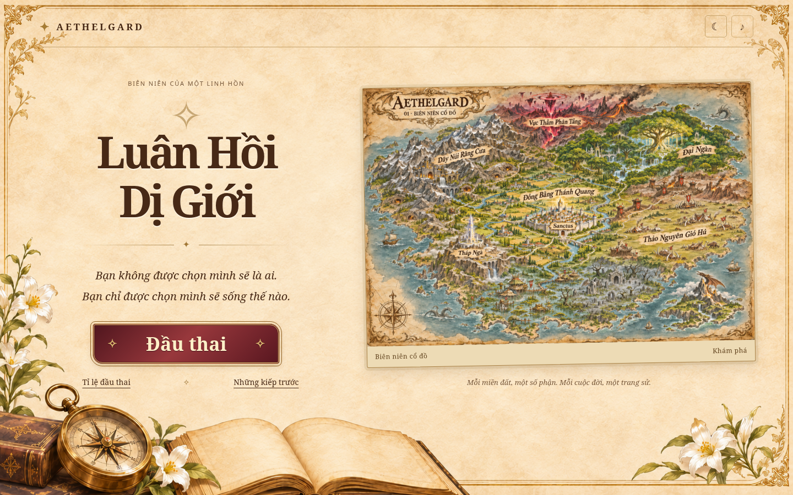
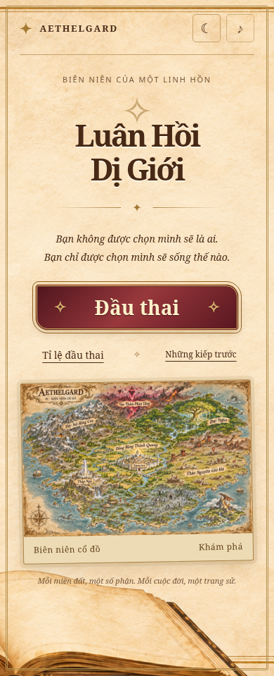

# Màn hình chính — Biên niên cổ thư

Phong cách được chọn là mẫu 2: giấy da sáng, chữ nâu, hoa văn cổ và nút đỏ rượu
viền đồng. Bản đồ vẫn là **Biên niên cổ đồ Aethelgard số 1** đã chọn trước đó,
ở `img/maps/aethelgard-01.png`. Không dùng bản đồ minh họa của ảnh mockup.

Nền trang trí `img/ui/home-chronicle.png` được tạo riêng từ phong cách mẫu 2.
Tiêu đề, nút, tỷ lệ đầu thai, lịch sử và ảnh bản đồ đều là thành phần HTML thật,
có thể dùng chuột, chạm và bàn phím. Trên máy tính là hai cột; điện thoại xếp
thành một cột. Nền giữ tỷ lệ hình trang trí trên điện thoại. Có biến thể cổ thư
sẫm khi bật giao diện tối; lựa chọn sáng/tối được giữ khi vào cuộc đời.

Bản đồ chỉ có trên màn hình chính. Chạm ảnh để phóng/kéo xem các miền đất,
Escape trở về. Tỉ lệ đầu thai và Những kiếp trước có thể mở/đóng độc lập.

## Máy tính

## Điện thoại

