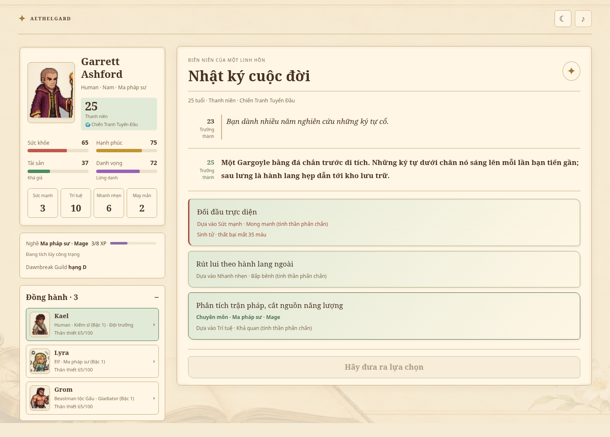
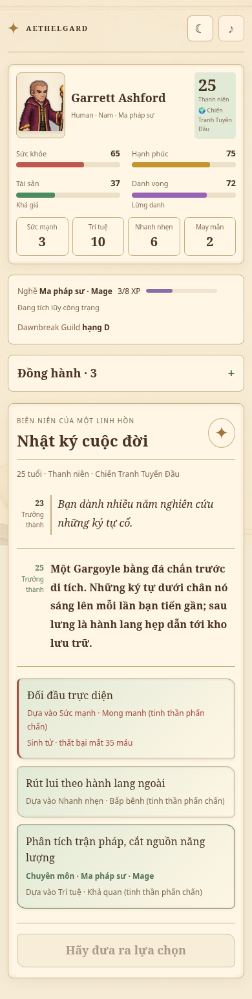
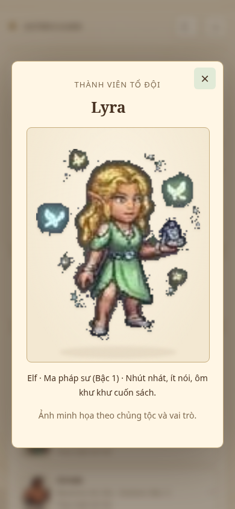

# Giao diện Biên niên cổ thư trong game

Các ảnh dưới đây là ảnh chụp bản game chạy thật. Phong cách đã chọn được áp dụng
cho đầu thai, hồ sơ cuộc đời, nhật ký, lựa chọn, tổ đội, chân dung thành viên và
tổng kết: giấy ngà, chữ nâu, viền đồng, nút lựa chọn xanh ngọc nhạt. Chế độ tối
là giấy sẫm với chữ sáng, giữ tương phản của bốn thanh trạng thái.

## Máy tính

Hai cột: hồ sơ/đồng đội bên trái, nhật ký và lựa chọn bên phải. Hồ sơ có thể
cuộn riêng khi dài; nhật ký vẫn dùng cuộn trang tự nhiên.

## Điện thoại

Một cột, bốn thanh trạng thái theo lưới 2 × 2. Mục Đồng hành mặc định thu gọn,
có thể bấm để mở; thao tác mở/đóng do người chơi chọn được giữ khi đổi kích thước.
Thanh chờ quyết định nằm dưới các lựa chọn để không che nội dung. Các cảnh báo
sinh tử vẫn có viền/chữ cảnh báo; nền lựa chọn giữ màu xanh nhạt.

## Ảnh nhân vật

Ảnh dùng atlas gốc, không nhuộm màu hoặc kéo giãn. Chân dung hồ sơ nhỏ của nhóm
người/dwarf/elf và hình thái gần người có vùng lấy nét riêng. Sinh vật thân rộng,
sừng, cánh, tai dài, Rồng, Slime, trẻ nhỏ và hình thái tiến hóa dùng toàn hình.
Màn đầu thai, hồ sơ thành viên và tổng kết luôn giữ toàn thân cùng vũ khí.
Các vùng lấy nét chỉ là tọa độ hiển thị, không tạo lại hay chỉnh pixel nguồn.

Ảnh được giải mã trước khi hiện để tránh lóe một phần atlas. Khung tự tính lại
khi đổi kích thước/mở hộp thoại. Ảnh chính không có chức năng phóng to; bấm tên
đồng đội vẫn mở hồ sơ thành viên như trước.

Thẻ cuộc đời và ảnh PNG xuất ra cũng sử dụng nền giấy, chữ nâu và hình toàn thân.
Bản đồ chỉ có trên màn hình chính. Giao diện không thay các chỉ số hay dữ liệu
cuộc đời đang lưu.

## Kiểm tra

- `npm run test:stories`: kịch bản/cơ chế cùng kiểm tra vùng hiển thị ảnh.
- `python3 tools/validate-sprites.py`: cấu trúc, nền trong suốt và các khung đã sửa.
- Trình duyệt: bản nguồn và `dist/game.html`, 320–1440 px, sáng/tối, chín nhóm
  chủng tộc, lựa chọn/focus, hộp thoại tổ đội lồng nhau, xuất thẻ và xem lại cuộc đời.

Xem [quy trình ảnh](SPRITES.md) và `tools/build-presentation.py` khi cập nhật atlas.
