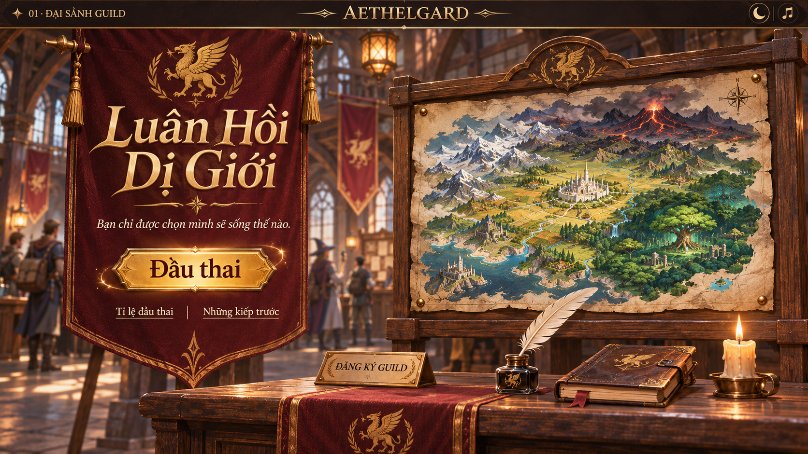
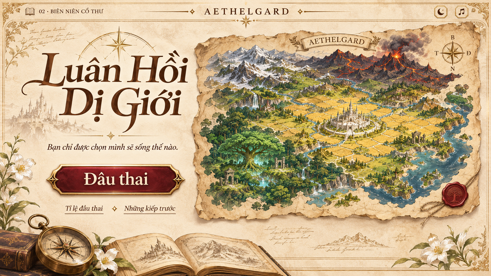
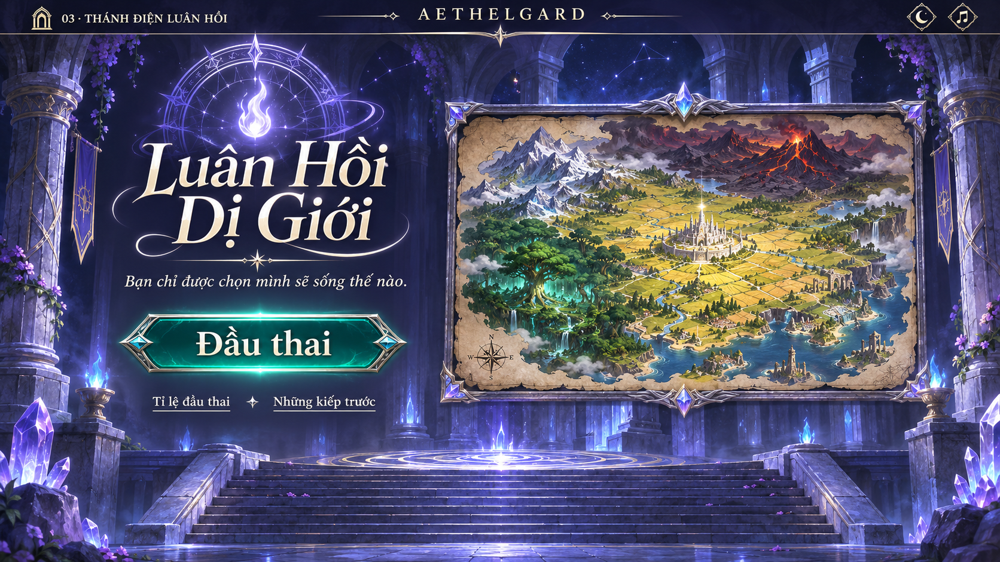
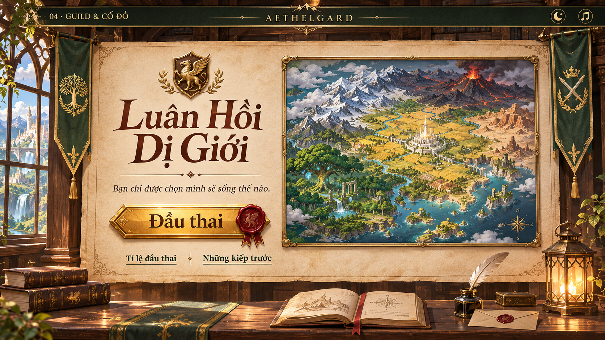

# Chọn màn hình chính — Luân Hồi Dị Giới

Bốn bản thiết kế để lựa chọn phong cách. Bấm vào ảnh để xem kích thước đầy đủ.

## 1. Đại sảnh Guild

Gỗ sẫm, cờ đỏ, ánh đèn ấm.

## 2. Biên niên cổ thư

Giấy da sáng, nét trang trí cổ, sắc đỏ rượu.

## 3. Thánh điện Luân Hồi

Đền đá, vòng triệu hồi, ánh sáng tím xanh.

## 4. Guild & Cổ đồ

Giấy da, huy hiệu vàng và cờ xanh trên nền đại sảnh gỗ.

