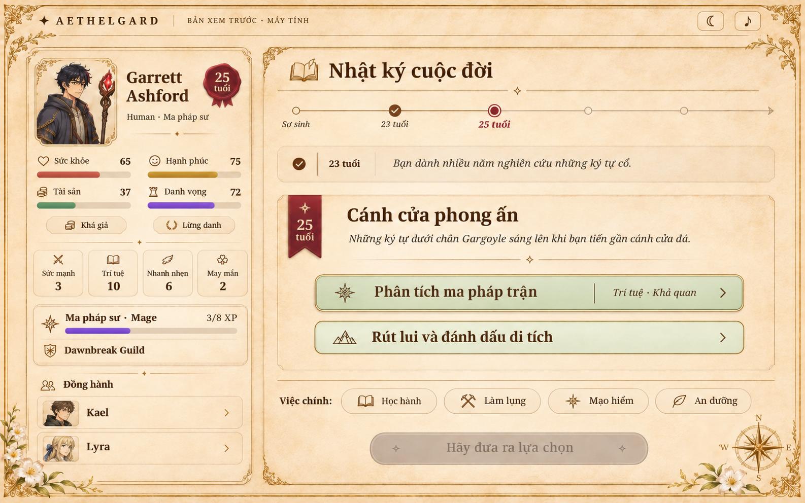
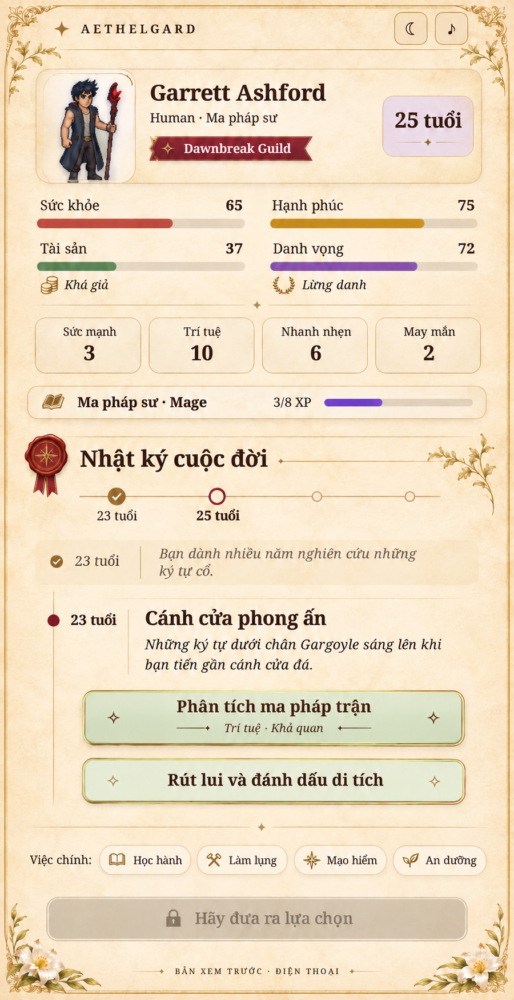

# Xem trước giao diện bên trong — Biên niên cổ thư

Đây là ảnh đề xuất thiết kế, chưa áp dụng vào giao diện chơi trong game.
Phong cách đồng bộ với màn hình chính mẫu 2: giấy da, chữ nâu, đường viền đồng,
nút lựa chọn xanh ngọc nhạt, chữ nâu đậm và bốn thanh trạng thái. Bản đồ vẫn chỉ ở màn hình chính.
Chữ, giá trị và chân dung trong ảnh minh họa sẽ dùng dữ liệu thật khi triển khai.

## Máy tính

Bố cục hai cột: hồ sơ/đồng đội bên trái, nhật ký và lựa chọn bên phải.

## Điện thoại

Bố cục một cột, bốn thanh trạng thái theo lưới 2 × 2.

